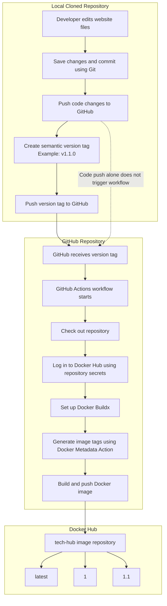

# Continuous Integration Project Overview

## Project Goal

The goal of this project is to create an automated Continuous Integration (CI) process that builds and publishes Docker container images to Docker Hub. When I make changes to my website, commit the changes, and push a new semantic version tag to GitHub, GitHub Actions automatically builds a new Docker image and publishes it to my Docker Hub repository.

This process makes it possible to maintain multiple versions of my website and use an older version if I need to roll back.

## Tools Used

- **Visual Studio Code:** Used to edit the website files, Dockerfile, GitHub Actions workflow, and project documentation.
- **Git:** Used for version control, saving changes, creating commits, and creating semantic version tags.
- **GitHub:** Stores my project repository and triggers GitHub Actions when I push a version tag.
- **GitHub Actions:** Automates the process of building and publishing Docker images.
- **Docker:** Used to build container images and run the website in containers.
- **Docker Hub:** Stores the published Docker images and their different version tags.
- **Docker Metadata Action:** Generates image tags such as `latest`, `1`, and `1.1`.
- **Docker Buildx:** Provides the build environment used by the GitHub Actions workflow.

## Continuous Integration Process Diagram

The following diagram shows how a change to my website becomes a new Docker image available on Docker Hub.



## Project Status

The project is working as expected. I successfully published two versions of my website using Git tags:

- `v1.0.0`: Original Tech Hub website.
- `v1.1.0`: Updated Tech Hub website with a new release banner.

I verified that both versions can be downloaded from Docker Hub and run in separate containers. The older version remains available for rollback.

# Project 6 – Continuous Integration and Semantic Versioning

## 1. Generating Git Tags

Git tags identify specific commits as releases. I used semantic versioning to organize my releases.

Semantic versioning follows this format:

`MAJOR.MINOR.PATCH`

- **Major:** Used for major or breaking changes.
- **Minor:** Used when adding new features.
- **Patch:** Used for bug fixes.

### Viewing Existing Tags

To see all tags in my Git repository, I used:

```powershell
git tag
```

### Creating a Tag

To create an annotated tag for a release, I used:

```powershell
git tag -a v1.0.0 -m "Release version 1.0.0"
```

For my second release, I used:

```powershell
git tag -a v1.1.0 -m "Release version 1.1.0"
```

### Pushing Tags to GitHub

To upload a tag to GitHub and trigger the workflow, I used:

```powershell
git push origin v1.0.0
```

For the second release:

```powershell
git push origin v1.1.0
```

## 2. Semantic Versioning Container Images with GitHub Actions

I modified my `docker-publish.yml` workflow to use Git tags instead of running whenever code is pushed to the main branch.

### Workflow Trigger

The workflow uses the following trigger:

```yaml
on:
  push:
    tags:
      - 'v*.*.*'
```

This means the workflow runs whenever a version tag matching this pattern is pushed to GitHub, such as `v1.0.0` or `v1.1.0`. It does not run on ordinary code pushes.

### Workflow Steps

The workflow performs these tasks:

1. Checks out the GitHub repository using `actions/checkout`.
2. Logs in to Docker Hub using the `DOCKERHUB_USERNAME` and `DOCKERHUB_TOKEN` repository secrets.
3. Sets up Docker Buildx.
4. Uses `docker/metadata-action` to generate Docker image tags from the Git version.
5. Uses `docker/build-push-action` to build the Docker image and publish it to Docker Hub.

### Generated Docker Image Tags

The metadata action generates three tags:

- `latest` – Always points to the newest release.
- `1` – Represents the major version.
- `1.0` – Represents the major and minor version.

For example, version `v1.1.0` generates `latest`, `1`, and `1.1`.

### Values to Update for Another Repository

If this workflow is used in another project, these values may need to be changed:

- **Docker Hub repository:** Update the image name in the `images` setting and the Docker image repository name.
- **GitHub secrets:** Create `DOCKERHUB_USERNAME` and `DOCKERHUB_TOKEN` in the new GitHub repository.
- **Build context:** Update `context: .` if the Dockerfile or application files are located somewhere else.
- **Workflow trigger:** I Changed the tag pattern if a different version naming format is used.

The Docker Hub username and repository name must match the actual Docker Hub account and repository.

### Workflow File

[View my Docker Publish Workflow](https://github.com/JawadNJ/ceg3120-cicd-Nejem-f26/blob/main/.github/workflows/docker-publish.yml)

## 3. Testing and Validating

### Testing GitHub Actions

I tested the workflow by pushing version tags to GitHub. I checked the Actions tab and confirmed that both releases completed successfully with a green check mark.

### Verifying Docker Hub Tags

I checked my Docker Hub repository and confirmed that the following tags were published:

- `latest`
- `1`
- `1.0`
- `1.1`

### Testing the Docker Images

I pulled both released versions from Docker Hub:

```powershell
docker pull jojonij/tech-hub:1.0
docker pull jojonij/tech-hub:1.1
```

I then ran each version in a separate container:

```powershell
docker run -d -p 8081:80 --name tech-hub-v1 jojonij/tech-hub:1.0

docker run -d -p 8082:80 --name tech-hub-v1-1 jojonij/tech-hub:1.1
```

I opened both websites in my browser:

- Version 1.0: `http://localhost:8081`
- Version 1.1: `http://localhost:8082`

I confirmed that version 1.0 displayed the original website and version 1.1 displayed the updated website with the new release banner.

This demonstrated that older Docker image versions remain available and can be used for rollback.

### Docker Hub Repository

[View my Docker Hub Repository](https://hub.docker.com/repository/docker/jojonij/tech-hub/general)

## 4. Screenshots and Evidence

The following screenshots are saved in the `images/screenshots/` directory:

- `version-1.0.png` – Original website running with Docker image version 1.0.
- `version-1.1.png` – Updated website running with Docker image version 1.1.
- `dockerhub-version-tags.png` – Docker Hub showing the published version tags.
- `github-version-1.1.png` – Successful GitHub Actions workflow for version 1.1.0.

These screenshots provide evidence that the workflow successfully builds, publishes, and maintains multiple versions of my Docker image.